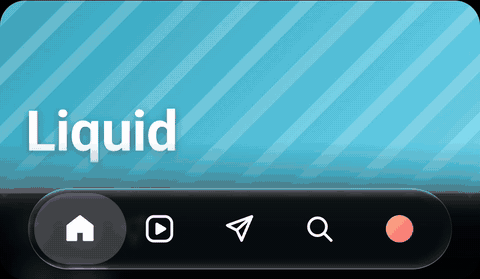
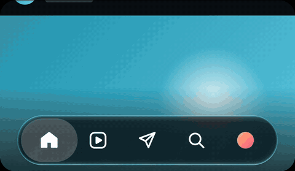
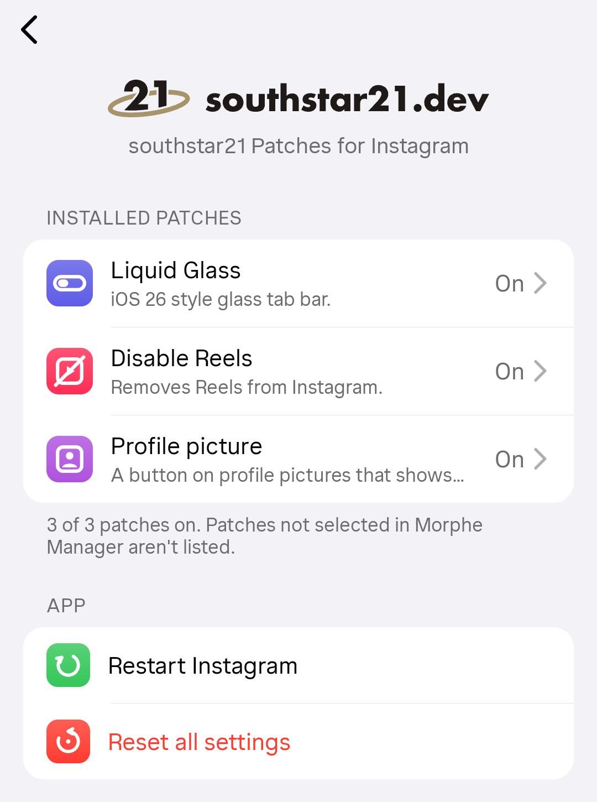

<p align="center">
  <picture>
    <source media="(prefers-color-scheme: dark)" srcset=".github/readme/southstar21-horizontal-cream.svg">
    
  </picture>
</p>

<p align="center">
  
  
  <br>
  <sub>The Liquid Glass bar in its iOS style (left) and southstar21 style (right), recorded in the settings' live preview.</sub>
</p>

<h3 align="center">Patches for Instagram, made with Morphe.</h3>

<p align="center">
  A Liquid Glass tab bar from iOS 26, Reels gone from your feed, a daily time budget for scrolling,<br>
  full size profile pictures and a settings menu inside the app to switch each one on and off.
</p>

<p align="center">
  <a href="#install">Install</a> ·
  <a href="#patches">Patches</a> ·
  <a href="#settings-menu">Settings menu</a> ·
  <a href="#development">Development</a> ·
  <a href="CHANGELOG.md">Changelog</a>
</p>

<p align="center">
  <a href="https://github.com/southstar21dev/southstar21-patches/releases/latest"></a>
  <a href="https://github.com/southstar21dev/southstar21-patches/releases"></a>
  <a href="https://github.com/southstar21dev/southstar21-patches/actions/workflows/release.yml"></a>
  
  <a href="https://morphe.software"></a>
  <a href="LICENSE"></a>
</p>

## Install

1. Install [Morphe Manager](https://morphe.software) on your phone.
2. Add this repo as a patch source: **[add southstar21 Patches to Morphe](https://morphe.software/add-source?github=southstar21dev/southstar21-patches)**. Or download `patches-x.y.z.mpp` from [Releases](https://github.com/southstar21dev/southstar21-patches/releases) and add it as a local file.
3. Download the Instagram **APKM** bundle from APKMirror, in a version listed under [Patches](#patches).
4. Patch it in Morphe Manager, choose the patches you want and install the result.

Patched apps are signed with a different key, so uninstall the Play Store version first.

> [!WARNING]
> Instagram's terms don't allow modified clients. Use these patches at your own risk.

## Patches

<!-- PATCHES_START EXPANDED -->
> **[v1.2.0](https://github.com/southstar21dev/southstar21-patches/releases/tag/v1.2.0)**&nbsp;&nbsp;•&nbsp;&nbsp;`main`&nbsp;&nbsp;•&nbsp;&nbsp;8 patches total
<details open>
<summary>📦 Instagram&nbsp;&nbsp;•&nbsp;&nbsp;8 patches</summary>
<br>

**🎯 Supported versions:**

| 454.0.0.54.77 |
| :---: |

| 💊&nbsp;Patch | 📜&nbsp;Description | ⚙️&nbsp;Options |
|----------|----------------|-----------|
| [Bypass signature check](#bypass-signature-check) | Stops Instagram rejecting apps by their signature, which a patched app no longer matches. |  |
| [Conscious gate](#conscious-gate) | Gives the home feed, Reels, Explore and stories a daily time budget. In the last 15 seconds they frost over and can only be scrolled, then a gate closes them until the next day. Searching for people, messages and profiles keep working. Off until you switch it on in the settings. |  |
| [Disable Reels](#disable-reels) | Removes reels from the home feed and Explore, and stops scrolling from one reel to the next. Each part is off until you switch it on in the settings. |  |
| [Hide ads](#hide-ads) | Removes sponsored posts, stories and reels, and ad units in the home feed. Each part can be switched off in the settings. |  |
| [Hide navigation buttons](#hide-navigation-buttons) | Adds settings to hide Search, Reels, Create, Messages and other tabs from the bottom bar. Every tab stays until you hide it in the settings. |  |
| [Liquid Glass navigation bar](#liquid-glass-navigation-bar) | Turns the bottom tab bar into a floating iOS 26 style Liquid Glass pill with live background blur and edge refraction. Refraction needs Android 13+, blur needs Android 12+, older versions get a tinted pill. | • Blur radius<br>• Refraction strength<br>• Extend content behind bar |
| [Remove build expired popup](#remove-build-expired-popup) | Removes the popup that appears after a while, when the app version ages. |  |
| [View profile picture](#view-profile-picture) | Adds a button on the profile picture of profile pages that shows the profile picture in full resolution and saves it to the gallery. |  |

</details>

<!-- PATCHES_END -->

### Liquid Glass navigation bar

Instagram's iOS 26 Liquid Glass design on Android, matched against screen recordings of the iOS app.

- **Floating glass tab bar.** A frosted pill with live background blur, a subtle refracting rim and a grey capsule behind the selected tab.
- **Shrinks while scrolling.** Scrolling down scales the whole bar down (every tab stays visible and tappable), scrolling up brings it back.
- **Gliding selection.** Drag along the bar to slide the grey selection capsule between tabs, as on iOS, with a haptic tick per tab; let go to open the tab underneath. Switch on *Glass while dragging* to turn the capsule into clear glass while it moves.
- **Adaptive tint.** The glass frosts more when what's behind it would make the icons hard to read, and turns dark on Reels and in dark mode.
- **Videos blur too.** Instagram normally plays videos in a separate layer apps can't see, which would leave the glass solid over them. *Blur videos behind the bar* (on by default) switches the player to Instagram's other way of drawing video, so the glass and the blur at the bottom of the screen blur videos like the rest of the feed.
- **southstar21 style.** An optional switch in the settings menu (off by default) gives the bar thicker glass that bends what's behind it towards the edges. A press swells the selection into a drop of clear glass that bends what's under its rim outward, with rainbow fringes at the edge; it wobbles, stretches as you drag it and ticks over each tab. The bar shrinks back behind the drop, leans and glows under your finger.
- **Customize navbar.** A page in the settings menu with a live preview of the bar pinned at the top: tap and drag along it, scroll the sample feed under it, and it changes as you move each slider.
  - **Under the preview:** light or dark, three backdrops (photos, text, colors), pause, hold to compare with the default look, and one-tap presets (iOS, Clear, Frosted, Bold, Minimal, Neon).
  - **A "?" on every setting** opens a short demo: the bar sweeps that one setting from low to high on its own, acting out a drag, taps or scrolling where that's what shows it. The demos are drawn live, so they add no files.
  - **Glass:** blur, refraction, opacity, vibrancy, clear edge, rim, end glare, shadow and a tint color.
  - **Shape:** height, side margin, bottom gap, roundness and tab inset.
  - **Selection:** shade, width, inset, 3D pill, edge colors and drop size.
- Taps, double taps and long presses on the tabs still go to Instagram untouched.

Android 13+ gets the full effect, Android 12 gets blur without refraction, and older versions get a translucent tinted pill.

| Option | Default | |
|---|---|---|
| Blur radius | 4 dp | How frosted the glass is (0 to 40). iOS Instagram barely blurs. |
| Refraction strength | 60 | How strongly the edge bends what's behind it (0 to 100). |
| Extend content behind bar | on | Lets feeds scroll under the bar so there's something to see through the glass. |

<details>
<summary>How it works</summary>

A hook in `InstagramMainActivity.onWindowFocusChanged` (an unobfuscated method, so it should survive app updates) starts the extension, which finds the tab bar by its resource name and gives it a background drawable that re-records the views behind it into a `RenderNode` each frame, then runs that through a blur and an AGSL refraction shader.

</details>

### Conscious gate

A daily time budget for the parts of Instagram made for endless scrolling, so you can still check in every day but stop where you chose to. Off by default: select it in Morphe Manager to include it, then switch it on from its page in the [settings menu](#settings-menu).

- **One shared budget.** The home feed, Reels, Explore, stories and post feeds share one daily budget, counted only while one of them is on screen. Messages, searching for people and profiles keep working the whole time.
- **Frost, then the gate.** In the last 15 seconds the gated screens frost over and can only be scrolled, with a badge counting down. Then a gate closes them until the new day starts and pauses Reels and stories. The tab bar stays usable, and swiping to Create or Messages still works.
- **Extra time, on purpose.** The gate can give you a few more minutes, but its button counts down first, so taking more time is a choice rather than a reflex.
- **Schedules.** Quiet hours keep the screens closed overnight, and a morning start keeps them closed until a set time.

| Setting | Default | |
|---|---|---|
| Gated screens | all on | Home feed, Reels, Explore, Stories and Post feeds, each with its own switch. Your own posts and saved posts stay open. |
| Weekday / weekend time | 20 / 30 min | The budget for Monday to Friday and for the weekend. |
| New day starts at | 4:00 | Scrolling after midnight still counts towards the night before. |
| Quiet hours | off | Closed from 23:00 until 07:00, both adjustable. |
| Morning start | off | Closed each morning until 09:00, adjustable. |
| Extra minutes | 5 min, once a day | How much the gate's button adds and how often; 0 times turns it off. |
| Wait before extending | 10 s | How long the button counts down before it can be used. |
| Gate message | | Your own words on the gate, instead of "That's the feed for today". |

<details>
<summary>How it works</summary>

The extension runs from the same main activity hook as the rest of the patches and counts time on a timer while the app is in focus. Each gated screen's largest list (or the whole screen for stories) is found by walking the view tree of its fragment; it is frosted with a `RenderEffect` blur on Android 12+ plus a tint, and a gate view placed over it lets drags through to the list while frosting, swallows taps once closed, and hands sideways swipes to Instagram's swipe navigation.

</details>

### Disable Reels

Takes Reels out of Instagram. Each part has its own switch on the patch's page in the [settings menu](#settings-menu), and the Reels tab itself is hidden with [Hide navigation buttons](#hide-navigation-buttons).

| Setting | Default | |
|---|---|---|
| Home feed | off | Drops reel posts and "Suggested reels" style units as the feed loads. |
| Explore | off | Drops Explore grid sections that contain a reel. Whole sections go, since removing single tiles would break Instagram's grid layouts. |
| Stop scrolling | off | A reel opened from a message or a profile plays alone, with swiping to the next one locked. |
| Block Reels player | off | Reels don't open at all, including ones sent in messages. |

<details>
<summary>How it works</summary>

Instagram parses every home feed item, and every Explore section, through one method each; the patch returns nothing for reels there, which Instagram already skips. The Reels player's pager is found by its view id (`clips_viewer_view_pager`), and the player itself is closed from `ClipsViewerFragment.onViewCreated` when blocked.

</details>

### Hide ads

Takes ads out of Instagram. Each part has its own switch on the patch's page in the [settings menu](#settings-menu).

| Setting | Default | |
|---|---|---|
| Sponsored posts | on | Ads in the home feed, Stories, Reels and feeds opened from Explore. |
| Ad units in the feed | on | Ad carousels and "Why am I seeing ads" prompts that come with the home feed. |

Ads Instagram had already loaded may still show once after switching it on.

<details>
<summary>How it works</summary>

Feed, Stories, Reels and the other feeds share one sponsored content controller, which receives every batch of ads Instagram fetches and slots them between posts. The patch empties each batch on arrival, which Instagram handles as a delivery with no ads. Ad units that come inside the home feed response (`AD`, ad pivots, ads feedback prompts) are dropped where each feed item is parsed, the same method Disable Reels uses.

</details>

### View profile picture

A small round button sits on the bottom left of the profile picture on every profile page, however it's opened: search, DMs, notifications or your own profile, where the story "+" stays on the bottom right.

- **Full resolution.** The picture opens fullscreen in its original size, growing out of the avatar and shrinking back into it when closed. The small picture shows straight away and the full size one replaces it once it's downloaded, with the resolution shown at the bottom.
- **Zoom and close.** Pinch or double tap to zoom, swipe down or press Back to close, tap to hide the controls.
- **Save it.** The download button saves the picture to **Pictures/Instagram**, exactly as Instagram serves it, without re-compressing.

<details>
<summary>How it works</summary>

Profile pages (`UserDetailFragment`) are tracked from `onViewCreated`, and each page's own view tree is watched so the button is added whenever its header is laid out, in any activity. It floats in the parent shared by the avatar (`row_profile_header_imageview_frame_layout`) and its story ring (`reel_ring`), which is drawn on top of the avatar, and follows the ring's position. On tap, the user is read live from the page's `UserDetailTabController`, which carries the full size picture (`hd_profile_pic_url_info`) once the profile has loaded.

</details>

### Hide navigation buttons

Off by default; select it in Morphe Manager to include it. Adds a **Navigation buttons** page to the settings menu with a switch for each tab: Search, Reels, Create, Messages, Activity (the heart, also the one at the top of the home page) and the rotating tab some accounts get, all off at first. Home and Profile always stay, because the menu button lives on Profile. Changes apply after Instagram restarts.

Hidden tabs are removed from the list Instagram builds the bar from, so you can't swipe into them either. If the tab Instagram would open at launch is hidden, Home opens instead.

### Bypass signature check

Instagram checks its own signature, which a patched app no longer matches. This stops it from rejecting itself.

### Remove build expired popup

Removes the popup Instagram shows once the installed version has aged, asking you to update.

## Settings menu



Every patched Instagram gets a **southstar21 Patches** button in the top bar of your own profile, next to Threads and ☰. It opens a menu listing every patch you included, each with its own page where it can be switched on and off and configured.

Patches you didn't select in Morphe Manager aren't listed. **Restart Instagram** applies settings that only take effect at launch, and **Reset all settings** puts everything back to its defaults.

<br clear="right">

## Development

```sh
GITHUB_ACTOR=<you> GITHUB_TOKEN=<token> ./gradlew :patches:buildAndroid
```

The Morphe Gradle plugin needs a GitHub token with `read:packages`, see the [Morphe setup docs](https://github.com/MorpheApp/morphe-patcher/blob/main/docs/2_1_setup.md#-prepare-the-environment). The patch bundle lands in `patches/build/libs/patches-<version>.mpp`.

<details>
<summary>Repository layout</summary>

```
patches/src/main/kotlin/app/southstar21/patches/
  <app>/
    shared/              Compatibility (app versions) and fingerprints shared by the app's patches
    misc/extension/      sharedExtensionPatch: bundles extensions/<app>.mpe into the app
    layout/<patch>/      UI patches (one folder per patch: the patch and its Fingerprints.kt)
    misc/<patch>/        Everything else
extensions/<app>/        Java code injected into the app, one Gradle module per app
  src/main/java/app/southstar21/extension/<app>/<patch>/
```

</details>

<details>
<summary>Adding a patch</summary>

1. **New app?** Create `extensions/<app>/` (copy `extensions/instagram/build.gradle.kts` and change the name and namespace), plus `patches/.../<app>/shared/Constants.kt` with its `Compatibility` and `misc/extension/SharedExtensionPatch.kt`.
2. Add the patch under `patches/.../<app>/layout/<patch>/` or `misc/<patch>/`, with `compatibleWith(...)` and, if it runs extension code, `dependsOn(sharedExtensionPatch)`.
3. Put its extension code in `extensions/<app>/src/main/java/app/southstar21/extension/<app>/<patch>/`.
4. Commit with a [conventional commit](https://www.conventionalcommits.org) message. A `feat:` or `fix:` pushed to `dev` publishes a pre-release; on `main`, a release.

**Showing an Instagram patch in the settings menu:**

1. In its extension class, add `public static boolean isIncluded() { return false; }` and a `public static final PatchSettings SETTINGS = new PatchSettings("<key>", "<Title>", "<description>", <Class>::isIncluded, ...settings)`, using `BooleanSetting` / `IntSetting` from `app.southstar21.extension.instagram.settings`. Pass `SettingsGroup`s instead of plain settings to split the page into titled sections, and chain `.icon(Icons.Glyph.X, color)` to give it an icon. Read values with `.get()`; mark settings `requiresRestart` if they're only read at startup.
2. Add `<Class>.SETTINGS` to the list in `settings/Settings.java`.
3. If the patch needs the main activity, start it from `InstagramHooks.onMainActivityWindowFocusChanged` behind `if (<Class>.SETTINGS.isActive())`.
4. In the Kotlin patch, call `markPatchIncluded("L<extension class>;")` in `execute`. Patch options can feed setting defaults by having the patch overwrite a static method the setting's default calls (see `LiquidGlassNavBarPatch`).

</details>

## License

Free software under the [GNU General Public License v3.0](LICENSE), based on the [Morphe patches template](https://github.com/MorpheApp/morphe-patches-template). See [NOTICE](NOTICE) for the Morphe name restriction.
